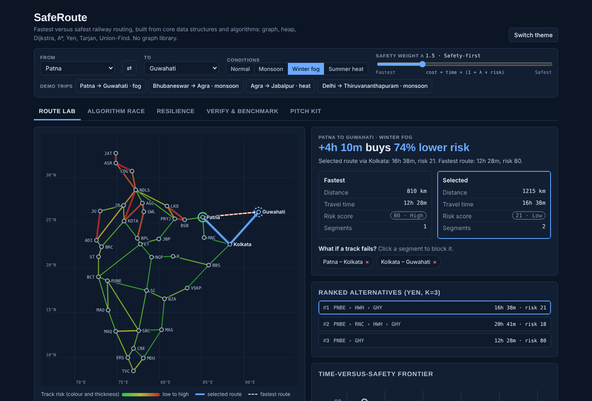

# SafeRoute

A railway routing engine that treats the **fastest** route and the **safest** route as two different answers. Every algorithm is written from scratch in plain JavaScript, with no graph library. The whole app is one self-contained file: open `index.html` in any browser.



## The idea

Stations are nodes and tracks are weighted edges. Each edge has a travel time and a risk score, and the router minimises

```
edge cost = travel time x (1 + lambda x risk)
```

Lambda is the safety weight. `lambda = 0` gives the fastest route; a higher lambda pays more time to avoid risk. Because cost never drops below travel time, the algorithms below stay correct.

Example (Patna to Guwahati, winter fog): the direct route takes 12h 28m at risk 80; the route via Kolkata takes 16h 38m at risk 21. About 4 extra hours buys roughly 74% lower average risk.

## What is implemented

| Concept | Where | Used for |
|---|---|---|
| Graph, adjacency list | `adj`, `E` | Network model |
| Binary min-heap | `MinHeap` | Cheapest frontier node in O(log n) |
| Dijkstra and A* | `search()` | One function; A* adds a great-circle-distance heuristic |
| BFS | `bfs()` | Fewest-stops baseline |
| Yen's K shortest paths | `yen()` | Ranked alternatives |
| Tarjan bridges and articulation points | `tarjan()` | Single points of failure |
| Union-Find | `DSU` | Counting connected networks after disruptions |
| Bellman-Ford | `bf()` | Independent oracle for testing |

## Tabs

- **Route Lab**: fastest versus selected route, time-versus-safety frontier, ranked alternatives, click-to-block tracks.
- **Algorithm Race**: Dijkstra and A* side by side with numbered expansion order.
- **Resilience**: bridges, articulation stations, and live component counts after blocking tracks.
- **Verify and Benchmark**: 8 self-tests and an all-pairs benchmark.
- **Pitch Kit**: a 5-minute script and likely questions with answers.

## Verification

The fast algorithms are checked against slow, obviously correct ones:

- Dijkstra and A* match a Bellman-Ford oracle on every station pair, across 4 conditions and 3 lambda values.
- Yen paths are loopless, unique, valid and sorted by cost.
- Tarjan bridges and articulation points match brute-force removal on random graphs.
- Union-Find components match a plain DFS count.

Measured over all 703 station pairs, A* expanded about 35% fewer stations than Dijkstra with identical optimal cost on every pair.

## Complexity

| Piece | Time |
|---|---|
| BFS | O(V + E) |
| Dijkstra, binary heap | O((V + E) log V) |
| A*, consistent heuristic | same worst case, fewer nodes expanded |
| Yen's K paths | O(K V (E + V log V)) |
| Tarjan | O(V + E) |
| Union-Find | O(alpha(n)) per operation |

## Limits

- The network is a simplified schematic of 38 major stations. Distances are straight-line distance x 1.22 and speeds are class averages. They are not timetable data.
- Risk scores are synthetic: a seeded base value per track, multiplied by region and season. The router accepts any risk source, so a real weather feed or predictive model could replace it.
- Static graph: no timetables, capacity, transfer times or directed tracks.

## Run it

Open `index.html` in a browser. To host it, enable GitHub Pages on the main branch.

## Author

Ravgun Kaur. Built to apply the DSA concepts from the Board Infinity DSA Summer Training (July 2026).
